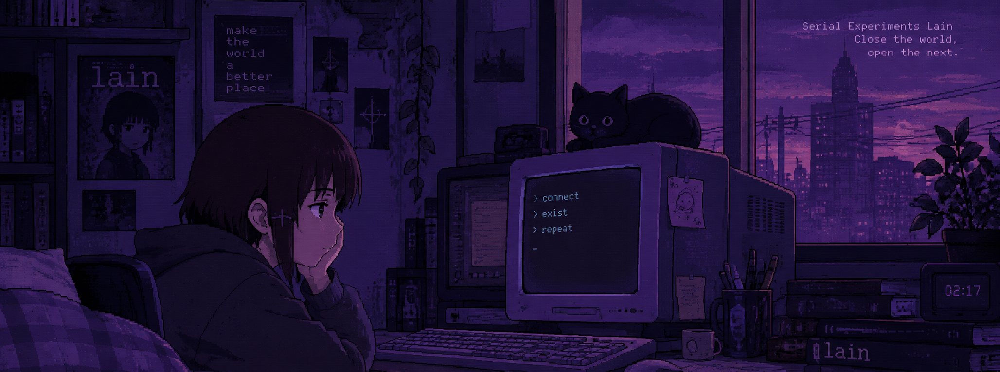

#Olá, eu sou a Geovana! 👋🏻

🎓 Estudante de Análise e Desenvolvimento de Sistemas no IFAM.

💻 Atualmente, estou aprendendo programação e desenvolvendo minhas habilidades em tecnologia.

💻 Linguagens: Python, JavaScript, C, HTML e CSS.

🛠️ Ferramentas: VS Code, Code::Blocks e PyCharm.

🐧 Sistema operacional: Linux Fedora.
